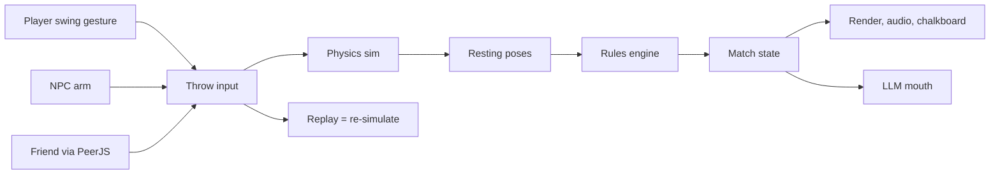

# Dusk at the Pits — 3D Horseshoes Plan

Oct 30, 2026 · @Rick · revised Oct 31, 2026

**Status:** Phases 0 and 1 passed playtesting (throwing feels good on PC and phone; a full hot-seat game played cleanly). Phase 2 (the court at dusk) is built and deployed for playtesting.

## Vision

A browser-based 3D horseshoes game played by official NHPA rules, against characterful AI opponents or a friend via a shared link. It is a just-for-fun project, so the bar is feel and charm, not feature count.

**Setting: a backyard court at golden hour that slides into night as the game goes on.**

- **Time of day tracks the score.** Sun low at 0 points; string lights flicker on mid-game; fireflies appear around the 20-point mark; full dusk for match point.
- **In-world chalkboard scoreboard** nailed to a fence post. Chalk animates in after each inning (tally marks, a little underline on a ringer). A small HUD overlay mirrors the score so it's always readable.
- **Persistent clay.** Every shoe leaves a dent, scuff or plug mark that stays. By game's end the pit is a record of the match.
- **The close-call cam.** When a shoe stops near the stake, the camera drops to ground level and a straightedge or caliper slides in to measure. This is the game's signature moment.
- **Ringer moment.** Slow-motion replay from a low angle, a proper steel *clang*, a dust puff.
- **Ambient detail.** Cicadas, a cooler by the stake, a dog that wanders past occasionally, the opponent's idle animations between throws.

## Decisions

The open questions from the first draft, now settled:

| Question | Decision | What it means for the build |
| --- | --- | --- |
| Realism vs arcade | **Realism** | Physics never bends to help a shoe. Difficulty comes from aim aids in the UI (ghost arc, release-timing cue) and from AI tuning, not from fudging outcomes. |
| Art style | **Realistic PBR** | See *Art direction* below. This makes performance on phones a real risk, so quality tiers are planned from Phase 2. |
| Doubles (2v2) | **Stretch goal** | Not in v1. The turn state machine should still model "players per side" so doubles fits in later without a rewrite. |
| First pitch after a no-score inning | **Follow the rule book** | Checked against the rulebook: whoever pitched last goes first (RULE 7 A.1). |
| Name | ***Dusk at the Pits*** | Final title. |

## Rules engine

The rules live in a pure TypeScript module with no 3D code, fed the final resting pose of each shoe and unit-tested against fixture scenarios. Defaults follow the [NHPA Official Playing Rules](https://www.horseshoepitching.com/rules/PlayingRules.html) (the January 2016 RGS Book); everything else is a toggle. Rule numbers below refer to that book, and the code cites them too.

**Court** ([NHPA backyard specs](https://www.horseshoepitching.com/gameinfo/backyard.html), [court specifications](https://horseshoepitching.com/rules/Specifications.html))

| Item | Value |
| --- | --- |
| Stake to stake | 40 ft |
| Foul lines | 37 ft (full distance) and 27 ft (short distance) from the opposite stake |
| Playing area | 6 ft wide × 46 ft long |
| Pit | 31–36 in wide × 43–72 in long, filled with clay (or sand/dirt in the backyard) |
| Stake | 1 in diameter steel, 14–15 in above the platform, top leaning 3 in toward the opposite stake; at least 21 in from the front and back of the pit |
| Backboard | At least 1 ft high, at least 3 ft behind the stake, as wide as the pit |
| Shoe | Max 2 lb 10 oz, 7¼ in wide, 7⅝ in long, opening no wider than 3½ in |

The stake lean and height matter to the physics (they change which shoes wrap, climb or bounce), so they go into the court model from Phase 0, not just the art.

**Scoring a shoe**

- **Ringer = 3.** A live shoe at rest encircling the stake, such that a straightedge touching the points or heel calks clears the stake (RULE 3 B.2). In code: the segment between the heel tips clears the stake radius, and the stake lies inside the shoe's outline, measured in the plane of the pit surface at the stake's base.
- **Within 6 in = 1.** A live non-ringer with any part within 6 in of the stake. Leaners count here at distance 0.
- **Out of count = 0.** Farther than 6 in.
- **Foul shoe = 0, removed** before the next shoe is pitched (RULE 5). Released with a foot on or over the foul line, or touching the backboard, platform, court frame or any ground outside the pit before it comes to rest. A live shoe must also come to rest within the pit. Live shoes knocked by other shoes are scored where they lie.
- **Backyard toggle:** leaner = 2.

**Game modes**

| Mode | How an inning scores | Default end |
| --- | --- | --- |
| Cancellation (default) | Opposing ringers cancel; only one player scores per inning; closest shoe(s) score; equal distances cancel | First to 40 |
| Count-all | Every live shoe scores for its owner, no cancellation | 40 or 50 shoes each, highest total; a tie plays two-inning tiebreakers |
| Backyard 21 | Cancellation, leaner = 2 | First to 21 |

The fixture suite covers every cancellation outcome: 0, 1, 2, 3, 4 (ringer + closest) and 6 (two ringers), plus 1-vs-1 ringer cancels, 2-vs-1 ringers, ties, leaners, a ringer on top of a ringer, and foul shoes.

**Flow of play**

- Singles: both players pitch from the same end, two shoes each per inning, then walk to the other end. Both of a player's shoes in an inning come from the same platform, so stance is chosen per inning, not per shoe (RULE 3 C.1).
- First pitch of the match: coin toss, with the winner choosing.
- Cancellation: whoever scored the last inning pitches first next. **After a no-score inning, the player who pitched last pitches first** (RULE 7 A.1). The rules engine owns this, so the game layer never decides turn order itself.
- Count-all: first pitch alternates in the rulebook's recommended pattern: the opening pitcher goes first in innings 1, 4–5, 8–9 and so on (RULE 7 A.2(a), required by RULE 7 B).
- Doubles (stretch goal): partners stand at opposite ends.
- Fouls: the release point is enforced by the controls, so foot fouls only happen if we add a step-up mechanic. Pit and backboard fouls happen naturally from physics.

## Throwing and physics

Throwing is the whole game: if one throw doesn't feel good in Phase 0, nothing later matters.

**Grips (choose before each throw).** Each sets the shoe's spin so it arrives open at a different distance.

| Grip | Character |
| --- | --- |
| ¾ turn | Shoe held by a side, flat spin; forgiving at short distance |
| 1¼ turn | Classic; good all-rounder |
| 1¾ turn | The pro grip; most consistent when mastered |
| Flip | End-over-end; easy to learn, lower ringer ceiling |

**Controls: the swing gesture.**

1. Pick grip (any time) and stance (left/right platform, once per inning).
2. Drag back to start the backswing, push forward to throw.
3. Forward speed → power. Sideways drift → pull and wobble. Release timing → arc height.
4. Aim aids scale with difficulty: a faint ghost arc and release-timing cue at Rookie, nothing at the top level. Aids only show information; they never change the throw.

Mouse and touch both work, so phones are in from day one.

**The throw input is the core data type.** A throw is fully described by `{ grip, stance, power, aim, wobble, releaseTiming, seed }`. Everything consumes it: the physics, the NPC, the network, and replays. Because the simulation is deterministic, the ringer replay is just the same input re-simulated with a slow-motion camera, so nothing needs to be recorded.

**Physics setup**

- **Shoe collider:** a chain of 8 rounded boxes along the arc (a flat bar fits a horseshoe better than capsules) plus small boxes for the heel and toe calks. Never a triangle mesh.
- **Stake:** a thin cylinder at its real lean, with continuous collision detection on the shoe, and a fixed small timestep for flight (e.g. 240 Hz substeps) to stop tunneling.
- **Clay, not trampoline:** on first pit contact the clay soaks up most of the shoe's horizontal speed, then heavy linear and angular damping take over, with a chance to plug (stick at the landing angle) on steep landings. Tunable per surface (wet clay, dry clay, sand).
- **Stake hits:** high restitution steel-on-steel for the clang and spin-off; shoes can wrap, bounce off, or climb and settle as leaners.
- **Settle detection:** the inning resolves once all shoes are below a velocity threshold for ~0.5 s, then the rules engine scores the resting poses. A hard timeout (~8 s) force-settles a shoe that keeps jittering.
- **Determinism rules for our own code:** Rapier's deterministic build only covers Rapier. Any custom force in the sim path (clay damping, plug chance) uses only `+ − × ÷ √`, which are exact in IEEE floats on every browser, plus a seeded PRNG. No `Math.sin`, `Math.exp` or `Math.random` in the sim, because those can differ across browser engines. Pin the Rapier version exactly.
- **Headless by design:** the physics module runs in Node with no renderer, so the tunneling test, AI calibration and determinism checks all run as plain scripts in CI.

## Art direction (realistic PBR)

- **Renderer:** Three.js `MeshStandardMaterial` / `MeshPhysicalMaterial`, AgX tone mapping, soft shadows from a single sun.
- **Assets:** CC0 sources only (Poly Haven, ambientCG) for HDRIs, clay, grass, wood and weathered steel textures, so there's nothing to license. The shoe and stake are simple enough to model directly.
- **Dusk cycle:** a procedural sky (Three.js `Sky`) driven by sun elevation, with the environment map re-baked through PMREM only while the light is changing, not every frame. String lights, pit floodlights and fireflies fade in on top. Full dark arrives a few points before the limit so match point is played under the lights.
- **Persistent clay:** the pit surface carries a small height field that each landing, skid and pickup stamps into; a shader turns it into dents, rims and darker freshly turned clay. It survives the whole match. The marks are visual only: physics still sees a flat pit.
- **Quality tiers:** auto-picked on load and adjustable: shadow map size, pixel-ratio cap, post-processing (bloom for string lights, depth of field for the close-call cam) on or off. Target 60 fps on desktop and 30+ fps on a mid-range phone.

## AI opponent

The opponent is split in two: a classic NPC **arm** that throws, and an optional LLM **mouth** that talks and nudges strategy. The game is fully playable with the LLM off.

**The arm (NPC)**

- Uses the same physics and the same throw inputs as the player — no cheating, no scripted outcomes.
- Computes an ideal throw for its preferred grip, then adds noise from its skill profile: aim spread, power spread, release-timing spread.
- **Pressure model:** spread widens when behind late, or facing a ringer it must cancel. Some characters choke; some get better.
- Difficulty = profile tuning, calibrated by simulating thousands of throws headlessly to hit a target ringer rate. This runs in Node, so it works in the cloud and can rerun in CI whenever the physics changes.

**The mouth (LLM, optional)**

- Trash talk and reactions after each shoe, in character.
- Light strategy calls in cancellation play: go for the ringer to cancel yours, or play a safe blocking shot.
- Runs against any OpenAI-compatible endpoint — e.g. llama.cpp serving qwen3.6-35b-a3b on the homelab. Short prompts, a game-state JSON in, one line plus an optional strategy tag out.
- **Staying under budget:** turn the model's thinking mode off, cap output at ~60 tokens, and constrain the reply with a JSON schema (llama.cpp supports this) so it never needs parsing repair. Fire the request as soon as the shoe is released, so the reply is usually ready by the time it settles.
- Fallback: a bank of canned lines per character when the endpoint is missing or slow (>1.5 s).

**Character roster (starting set)**

| Character | Grip | Target ringer % | Personality |
| --- | --- | --- | --- |
| The Rookie | Flip | ~8% | Hopeful, apologetic; improves over a season |
| Mae | Flip, 27 ft line | ~25% | Says almost nothing; never chokes |
| Uncle Dale | 1¾ turn | ~35% | Purist, insufferable after a double |
| The Professor | 1¼ turn | ~50% | Narrates physics and probability; overthinks under pressure |

Ringer percentages are design targets for difficulty tiers, tuned in playtesting.

## Multiplayer

Two stages: hot-seat on one device first, then online play by sending a friend a link.

**Hot-seat.** Pass the mouse or phone. Comes nearly free once turns and the rules engine exist, so it ships with Phase 1.

**Online (peer-to-peer).**

- Host clicks *Play a friend*, gets a room code and a shareable link.
- Connection: WebRTC data channel via PeerJS; its public broker handles the handshake, so there's no game server to run.
- **Send inputs, not physics.** Each throw is one throw-input message. Both browsers simulate the same flight with Rapier's deterministic build.
- **Host is the referee.** After a shoe settles, the host sends its final pose; the guest snaps to it if anything drifted. Scores always come from the host.
- Version check on connect: both peers must run the same build, since determinism only holds within one build.
- Extras: emote buttons and quick-chat lines; reconnect if a tab drops mid-game.

**Fallback:** if a strict NAT blocks the peer connection, add a TURN server or a tiny WebSocket relay on the homelab.

## Tech stack and architecture

A static TypeScript web app: Vite + Three.js for rendering, Rapier (`@dimforge/rapier3d-deterministic`, WASM) for physics, PeerJS for online play, Vitest for tests, Playwright for browser smoke tests, hosted on GitHub Pages. No game server.

The Rapier build with the WebAssembly inlined (`-compat`) keeps setup simple but makes the bundle about 1.8 MB gzipped. If load time on phones matters, switch to the build with a separate `.wasm` file in Phase 2.

The player, the NPC and a remote friend all produce the same kind of throw input, so physics, scoring and replays work identically for all three.

**Module layout**

| Folder | Owns |
| --- | --- |
| `src/rules` | Scoring, ringer test, game modes, turn order; no 3D imports |
| `src/physics` | Rapier world, shoe collider, clay behavior, settle detection; no render imports |
| `src/render` | Stage (renderer, bloom, quality tiers), dusk cycle, court and props, clay marks, chalkboards, close-call cam, cameras |
| `src/input` | Swing gesture for mouse and touch, grip picker |
| `src/game` | Throw session, practice, inning state machine and match flow, tuning panel |
| `src/ui` | Menu and match cards: setup, coin toss, handoff, inning summary, game over |
| `src/ai` | `arm` (NPC throws, skill profiles) and `mouth` (LLM client, canned lines) |
| `src/net` | PeerJS rooms, input messages, host-authoritative results |
| `src/audio` | Clang, thud, crowd and ambience via Web Audio |
| `tools/` | Headless scripts: tunneling test, AI calibration, determinism check |

The two "no imports" rules are enforced by an architecture test, which keeps `rules` and `physics` runnable in Node. The same test bans `Math.sin`-style functions from simulation code.

## Build phases

Seven phases, each ending in something playable. Phase 0 is the gate, because nothing else matters if throwing isn't fun. The rules engine has no dependency on physics, so it is written alongside Phase 0 rather than after it.

| Phase | Goal | Contents | Exit criteria |
| --- | --- | --- | --- |
| 0 | Throwing feels good | Graybox court at real dimensions, one shoe, swing gesture, Rapier flight, clay damping, stake collision, settle detection. **In parallel:** rules engine and its fixtures. | 1,000 shoes fired at the stake with zero tunneling; ringers are possible but rare; Rick enjoys throwing 20 in a row on PC and phone. |
| 1 | A real match | Inning state machine, all three game modes, hot-seat, HUD score, basic thud/clang audio. | A full 40-point cancellation game played hot-seat; every rules fixture passes. |
| 2 | The court at dusk | PBR art pass, dusk cycle tied to score, chalkboard, persistent clay, close-call cam, quality tiers. | Hits the fps targets; the close-call cam fires on every near shoe and the measurement matches the rules engine. |
| 3 | Opponents | NPC arm, skill profiles, pressure model, headless calibration, the four characters with canned lines. | Each character's simulated ringer rate within ±3 points of its target. |
| 4 | Play a friend | PeerJS rooms, input messages, host referee, version check, reconnect, emotes. | A full game between a phone and a PC on different networks, with no score disagreement. |
| 5 | The mouth | LLM client, JSON-schema replies, strategy tags, timeout fallback. Done locally (see below). | Replies land under 1.5 s most of the time; pulling the network cable mid-game falls back to canned lines with no stall. |
| 6 | Polish | Ringer slow-mo replay, dust and fireflies, the dog, ambience, the Rookie's season arc. Doubles if it's still fun to add. | It feels finished. |

Phases 1–4 can overlap once Phase 0 lands; Phase 6 polish can leak in anywhere it's cheap and fun.

## Development environment

Cloud works well for this project: it's a static web game with no native dependencies, so nearly everything can be built in a cloud session. The cloud can't judge how the game *feels*, so pair it with an auto-deploy.

**Recommended loop**

1. The `horseshoes` repo is attached to the cloud coding session.
2. Claude writes code, runs the unit tests, headless physics scripts and a production build in the cloud, and pushes to a branch.
3. A GitHub Actions workflow runs the same checks, then deploys: the default branch (`master`) to the site root and each branch to `/preview/<branch>/` on the Pages site. (GitHub Pages hosts one site per repo, so per-branch previews are subfolders, with Vite's `base` set per build.)
4. You play the result on any device — PC, phone, or your friend's laptop — and leave feedback.

Claude can also load the game in headless Chromium in the cloud to catch a blank screen or a console error and take screenshots, which covers crashes and layout, but not feel.

**What runs where**

| Work | Cloud | Your PC |
| --- | --- | --- |
| Rules engine, tests, scaffolding | Yes | Yes |
| Physics tunneling tests, AI calibration | Yes (headless) | Yes |
| Physics tuning by feel | Via deployed preview | Faster (hot reload) |
| Online multiplayer testing | Via deployed preview | Yes |
| LLM opponent against the homelab | No — can't reach your LAN | Yes |

A good split: start in the cloud for Phases 0–4, and switch to local (Claude Code on your PC) for the feel-tuning sessions and Phase 5, where the game needs to talk to llama.cpp. The repo is the same either way.

## Risks

| Risk | Mitigation |
| --- | --- |
| Shoe tunnels through the 1 in stake | Capsule-chain collider, CCD, high substep rate; a headless test firing 1,000 shoes at the stake, run in CI |
| Throwing feels floaty or random | Phase 0 is only feel; ship nothing else until it's fun |
| Clay looks like a trampoline | Custom damping and plug logic, tuned against real throw videos |
| Online clients disagree on a landing | Deterministic Rapier build, IEEE-exact custom forces, build-version check, plus host-authoritative final poses |
| PBR is too heavy for phones | Quality tiers from Phase 2, env-map re-bake only on score change, fps targets in the Phase 2 exit criteria |
| LLM slow or unreachable | Thinking off, short JSON-schema replies, request fired at release, hard timeout and canned-line fallback; LLM never blocks a turn |
| Hosted HTTPS page can't call an HTTP LAN endpoint | Run locally for LLM play, or put llama.cpp behind HTTPS on the homelab (with CORS enabled for the Pages origin) |
| Rules drift from the book | Every rule is a fixture test citing its rule number in the RGS Book |
